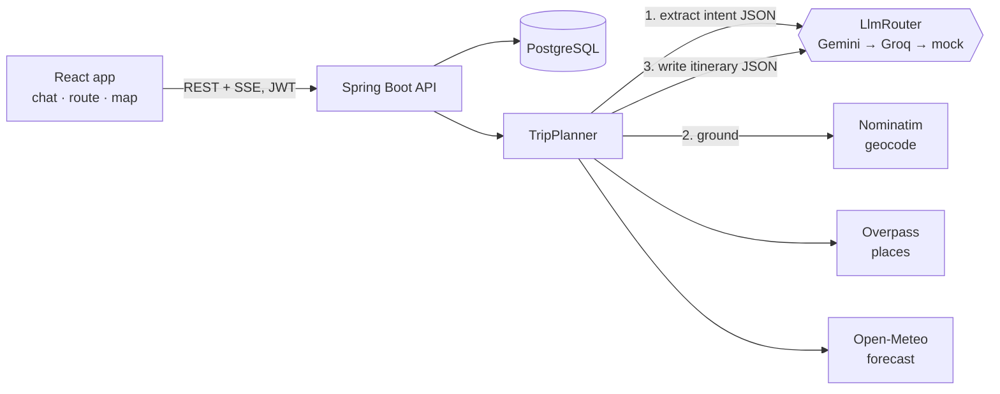

# Ghoomo — GenAI travel planner

Type *"4 days in Goa from Kolkata under ₹25k, we love beaches"* and get a day-by-day itinerary built from
real places, the live forecast for your dates and costs in rupees. Then keep chatting to change it.

**Stack:** React + TypeScript + Tailwind · Spring Boot 3 (Java 21) · PostgreSQL · Gemini / Groq · OpenStreetMap,
Open-Meteo and Frankfurter. Everything runs on free tiers.

---

## What it does

- **Streaming AI chat.** Replies stream token by token over Server-Sent Events, with live status lines
  ("Looking up places to visit around Jaipur…") while the planner works.
- **Grounded itineraries, not guesses.** Before the model writes anything, the backend geocodes the destination,
  pulls nearby attractions, nature spots and restaurants from OpenStreetMap, and fetches the forecast. The model
  plans from that data and returns strict JSON, which the backend validates and repairs.
- **Map + route view.** Each day is a coloured route of stops, pinned on a Leaflet map. Click a day to focus it.
- **Editable trips.** Drag to reorder stops, remove what you don't want, rename, set dates and budget; totals update live.
- **Personalisation.** Home city, travel style, budget and interests are fed into every prompt.
- **Provider failover.** Gemini first, Groq if Gemini rate-limits or errors, then an offline mock planner so the
  demo never dies. The same mock lets the whole app run with **no API keys at all**.
- **Production touches.** JWT auth, Flyway migrations, validation with field-level errors, global error handling,
  per-user rate limiting, Caffeine caching of external calls, OpenAPI docs, integration tests, Docker, CI.

## Architecture



**One chat turn:**

1. Save the user's message; load the last 12 turns.
2. **Intent extraction**: the LLM returns `{intent, destination, days, budgetInr, startDate, travelers, interests}`.
   Follow-ups like *"make it 5 days"* reuse details from earlier turns.
3. If it's a plan request, **ground it**: geocode, nearby places (Overpass), forecast (if dates are within 16 days).
4. **Plan**: the LLM gets a `TRIP CONTEXT` JSON and must answer with the itinerary schema. Invalid JSON gets one
   repair retry. The backend then renumbers days, snaps activities to known coordinates, drops pins that land
   more than 150 km away, recomputes the total and attaches the weather.
5. Save the itinerary, push it to the client as an `itinerary` event, then stream a short summary.
6. Otherwise, stream a normal travel-assistant reply.

SSE events: `status` → `itinerary`? → `token`* → `done` | `error`.

## Project layout

```
backend/                       Spring Boot API
  src/main/java/com/ghoomo/
    ai/          LlmProvider, GeminiProvider, GroqProvider, MockLlmProvider, LlmRouter (failover)
    planner/     TripPlanner (the pipeline), PromptTemplates, TripIntent
    travel/      Geocoding, Places (Overpass), Weather, Currency clients + Gazetteer fallback
    chat/        Sessions, messages, SSE controller
    itinerary/   Entity, CRUD service/controller, ItineraryPlan schema, JSON extraction
    user/        Auth (register/login), profile & preferences
    security/    JWT service + filter, SecurityConfig
    common/      Error handling, rate limiter
  src/main/resources/db/migration   Flyway SQL
frontend/                      React + Vite
  src/pages/       Landing, Auth, Planner, Trips, TripDetail, Settings
  src/components/  ChatPanel, RouteItinerary, TripMap, AppShell
  src/lib/         api client, SSE stream reader, auth context
  scripts/mock-api.mjs   Node stand-in for the API (UI work without Java)
```

## Run it locally

You need **Java 21**, **Maven** and **Node 20+**.

### 1. Backend

```bash
cd backend
mvn spring-boot:run
```

That's it: with no configuration it uses an in-memory H2 database and the offline mock planner.
API on http://localhost:8080, Swagger UI on http://localhost:8080/swagger-ui.html.

To use real AI, export one or both free keys first:

```bash
export GEMINI_API_KEY=...   # https://aistudio.google.com/apikey
export GROQ_API_KEY=...     # https://console.groq.com/keys
mvn spring-boot:run
```

> Tip: run `mvn wrapper:wrapper` once to add `./mvnw`, so others can build without installing Maven.

### 2. Frontend

```bash
cd frontend
npm install
npm run dev        # http://localhost:5173, proxies /api to :8080
```

No Java handy? `npm run mock` starts a Node stand-in for the API on :8080 with the same endpoints.

### Postgres instead of H2

```bash
docker compose up --build     # Postgres + API on :8080
```

## Configuration

| Variable | Default | Purpose |
|---|---|---|
| `GEMINI_API_KEY` | — | Primary LLM (free tier: Flash models) |
| `GEMINI_MODEL` | `gemini-flash-latest` | Any Gemini model id |
| `GROQ_API_KEY` | — | Fallback LLM |
| `GROQ_MODEL` | `openai/gpt-oss-120b` | Check the Groq console for current model ids |
| `AI_MOCK_FALLBACK` | `true` | Use the offline planner when no provider answers |
| `AI_PROVIDER_ORDER` | `gemini,groq` | Which provider is tried first |
| `GEMINI_TIMEOUT_SECONDS` / `GROQ_TIMEOUT_SECONDS` | `25` / `60` | Wait before failing over to the next provider |
| `DATABASE_URL` / `_USERNAME` / `_PASSWORD` | H2 in memory | JDBC URL, e.g. `jdbc:postgresql://host:5432/postgres?sslmode=require` |
| `JWT_SECRET` | dev value | **Set in production**, 32+ characters |
| `CORS_ORIGINS` | `http://localhost:5173` | Comma-separated frontend origins |
| `CHAT_RATE_PER_MINUTE` | `8` | Per-user message limit, protects free LLM quota |
| `VITE_API_URL` (frontend) | empty | Backend URL in production |

Free-tier notes: Gemini's free tier may use your prompts to improve Google's models, so don't send real personal
data through it. Free limits change often; check Google AI Studio and the Groq console for your current quotas.

## Deploy for free

1. **Database**: create a Supabase or Neon Postgres project and copy its connection details.
2. **Backend**: on Render (no card, sleeps after 15 idle minutes) or Koyeb (card required, always on), create a
   web service from `backend/` using the Dockerfile. Set `DATABASE_URL`, `DATABASE_USERNAME`,
   `DATABASE_PASSWORD`, `JWT_SECRET`, `GEMINI_API_KEY`, `GROQ_API_KEY` and `CORS_ORIGINS=https://<your-app>.vercel.app`.
   The Dockerfile caps the JVM heap to fit 512 MB instances.
3. **Frontend**: import the repo on Vercel with root directory `frontend`, and set
   `VITE_API_URL=https://<your-api-host>`. `vercel.json` handles client-side routes.

On Render's free tier, open the app a minute before a demo so the backend has woken up.

## API

Full interactive docs at `/swagger-ui.html`. Summary:

| Method | Path | |
|---|---|---|
| POST | `/api/auth/register`, `/api/auth/login` | Get a JWT |
| GET / PUT | `/api/me` | Profile and travel preferences |
| POST / GET | `/api/chat/sessions` | Create / list conversations |
| GET | `/api/chat/sessions/{id}/messages` | History |
| POST | `/api/chat/sessions/{id}/messages` | Send a message, **SSE reply** |
| DELETE | `/api/chat/sessions/{id}` | Delete a conversation |
| POST | `/api/itineraries/generate` | One-shot plan from a prompt (non-streaming) |
| GET | `/api/itineraries`, `/api/itineraries/{id}` | List / get |
| PUT | `/api/itineraries/{id}` | Save edits |
| PATCH | `/api/itineraries/{id}/days/{day}` | Replace one day's activities |
| DELETE | `/api/itineraries/{id}` | Delete |
| GET | `/api/travel/geocode`, `/places`, `/weather`, `/currency` | Cached public data lookups |

## Tests

```bash
cd backend && mvn test
```

- `ApiFlowIntegrationTest` runs register → generate → edit → list over HTTP against H2, with the mock LLM and
  external APIs pointed at a closed port, so it needs no network.
- `MockLlmProviderTest` covers intent extraction, including follow-up turns.
- `PlanJsonTest` covers pulling JSON out of messy model replies.

## Ideas for next steps

- Hotel and transport cost estimates from origin to destination
- Share a read-only trip link; export to PDF or calendar
- Group trips with shared editing
- Streamed itinerary building (days appearing one by one)
- Evaluate prompts: a small test set of trip requests scored for JSON validity and budget adherence

---

Map data © OpenStreetMap contributors. Weather by Open-Meteo. Exchange rates from Frankfurter (ECB).
